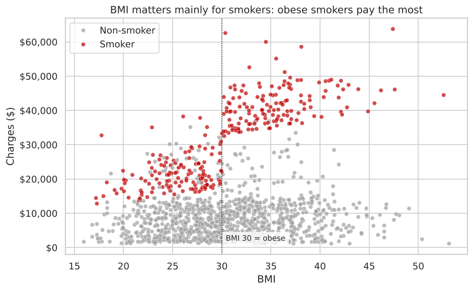
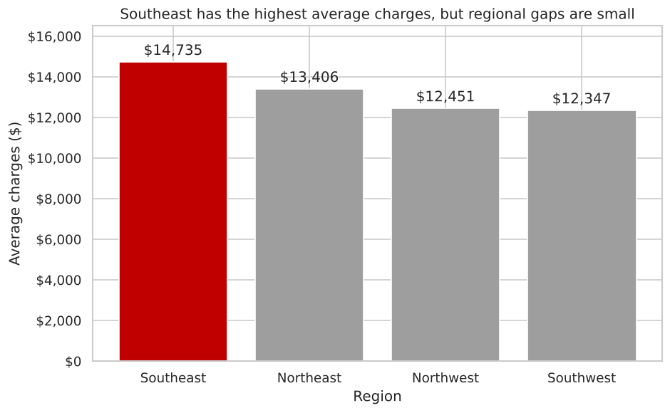
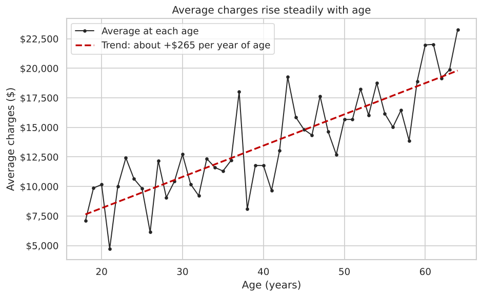
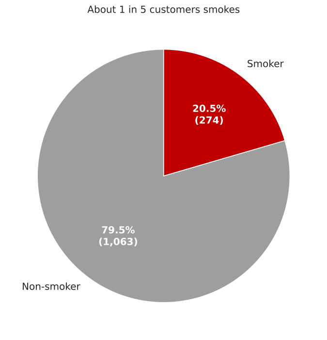
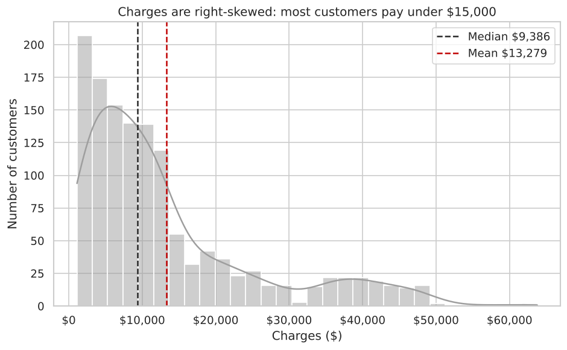
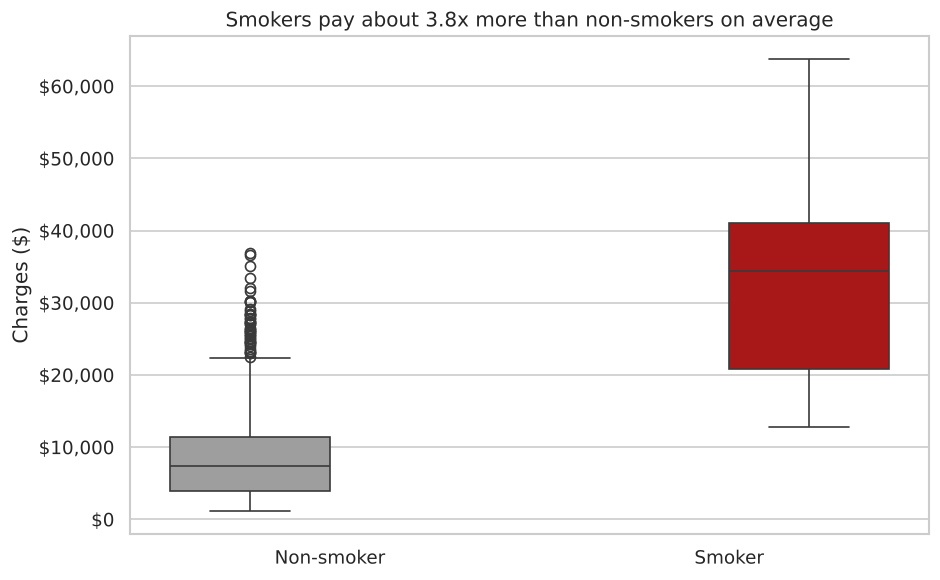
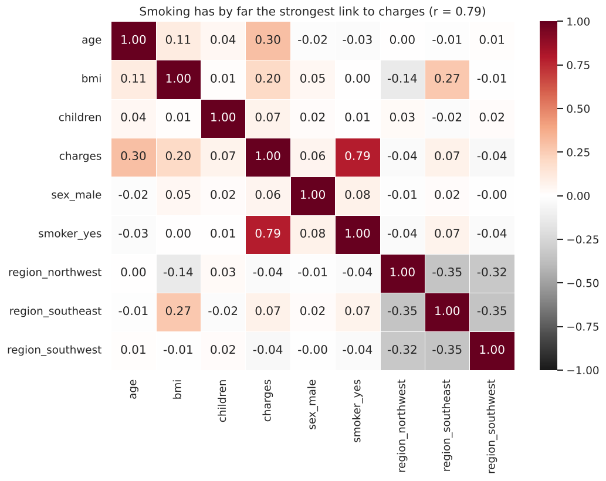

# Insurance Charges Analysis

**What drives medical insurance costs?** An exploratory data analysis of 1,337 insurance customers using Python (Pandas, Matplotlib, Seaborn).

**Author:** Paul O. Bankole, Junior Data Analyst

---

## Business problem

A health insurance company wants to know which customer factors influence medical insurance charges the most, so it can price policies more accurately and give customers better advice.

## Key findings

| Factor | Finding | Correlation with charges |
|---|---|---|
| **Smoking** | Smokers pay **3.8× more** on average ($32,050 vs $8,441). They are 20.5% of customers but account for **49% of all charges**. | **r = 0.79** |
| **Age** | Charges rise by about **$265 per year of age**, from $9.7k (18–34) to $17.9k (50–64). | r = 0.30 |
| **BMI** | BMI matters mainly **for smokers**. Smokers with BMI 30+ average **$41,558**, nearly double smokers below 30 ($21,363). | r = 0.20 |
| Region, sex, children | Small differences, largely explained by differences in smoking and BMI. | all \|r\| < 0.07 |



## Recommendations

1. **Price mainly on smoking status, and verify it.** It is by far the strongest driver of charges.
2. **Target stop-smoking and weight-management programmes at smokers with BMI 30+**, the highest-cost group (about $41.6k a year).
3. **Use age bands, and avoid pricing on region or gender.** Age has a steady, predictable effect, while regional and gender gaps are small.

## Visualisations

| | |
|---|---|
|  |  |
|  |  |
|  |  |

## Approach

1. **Inspect:** loaded the data with Pandas and used `.head()`, `.info()`, `.shape` and `.describe()`.
2. **Clean:** found no missing values; removed 1 duplicate row; converted text columns to `category`.
3. **Explore:** summary statistics, plus `groupby` comparisons by smoker, sex, region and number of children.
4. **Transform:** created `bmi_category` (WHO bands) and `age_group` (18–34 / 35–49 / 50–64) with `pd.cut()`.
5. **Visualise:** bar, line and pie charts in Matplotlib; histogram, boxplot, scatter plot and correlation heatmap in Seaborn.
6. **Interpret:** summarised the drivers and turned them into business recommendations.

## Repository structure

```
insurance-charges-analysis/
├── data/
│   ├── insurance.csv                 # raw dataset (1,338 rows, 7 columns)
│   └── cleaned_insurance.csv         # cleaned output with bmi_category and age_group
├── notebooks/
│   └── insurance_charges_analysis.ipynb
├── images/                           # charts exported from the notebook
├── presentation/
│   ├── Insurance_Charge_Analysis_Paul_O_Bankole.pptx
│   └── Insurance_Charge_Analysis_Paul_O_Bankole.pdf
├── requirements.txt
└── README.md
```

## How to run

```bash
git clone https://github.com/Palbanks12/insurance-charges-analysis.git
cd insurance-charges-analysis
pip install -r requirements.txt
jupyter notebook notebooks/insurance_charges_analysis.ipynb
```

To run it in **Google Colab** instead, open the notebook from GitHub (File → Open notebook → GitHub tab), upload `data/insurance.csv` into the Colab session, then choose Runtime → Run all.

## Dataset

The dataset has 1,338 records with the columns `age`, `sex`, `bmi`, `children`, `smoker`, `region` and `charges`. It is the publicly available *Medical Cost Personal Datasets* ([Kaggle](https://www.kaggle.com/datasets/mirichoi0218/insurance)), which was supplied as part of a data analysis course project.

## Limitations

- This is an observational dataset, so correlation shows association, not causation.
- Some groups are small (e.g. only 18 customers with 5 children), so their averages are unreliable.
- `charges` is right-skewed (median $9,386, mean $13,279), so medians describe a typical customer better than means.

## Tools

Python · Pandas · NumPy · Matplotlib · Seaborn · Jupyter / Google Colab
